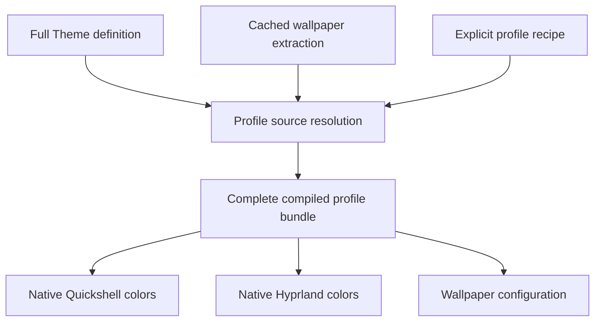

# System architecture

## Native configuration and composition

The shell is lightweight Quickshell QML, with Hyprland behavior expressed in native Lua. Installation paths and executable roles are explicit in config.ini. Geometry, motion and keyboard behavior remain native configuration; a color Theme never changes them.

Theme sources preserve complete named palettes and subsystem-native color settings. Profile recipes combine wallpaper selections, a Theme or wallpaper-derived source, user output overrides and configured subsystem targets. A focused compiler produces a complete cache bundle containing resolved palette data and native QML/Lua/wallpaper projections. GTK and Qt get their own adapters when implemented.

## Boundaries

Definitions and saved choices live under XDG config; derived extraction/build data live under XDG cache. A small coordinator composes focused scripts; target renderers receive explicit inputs and outputs. Installation bootstrap is independent of color bundle publication.

Import creates inactive definitions. Catalog listing reads metadata only. Preview reads one source. Final Save and apply validates/builds the complete draft before persistence and native activation. Native partial failures are visible, not disguised as successful activation.

No product daemon, custom IPC, DE settings app, hidden device names or silent fallback states. Defaults are explicit user configuration. Test sessions have private HOME/XDG roots and cannot mutate host theme files.

Related decisions: [[theme-profile-bundles]], [[xdg-runtime-and-theme-schema]], [[shared-style-and-toolkit-integration]], [[isolated-nested-test-environment]].
